# Response 01 — AI Workflow Reliability in 2026 — Verified Completion

**Outline.** The report first defines an AI-enabled workflow and its control architecture, then follows a cancellation-and-refund case from request through delayed reconciliation. It next establishes a lifecycle failure taxonomy, a verification hierarchy, and a remediation taxonomy; tests the distinction between conversational and business-state verification; generalizes the framework across other business functions; ranks diagnostic priorities; translates the top ten risks for six organizational audiences; and closes with a field doctrine for a bounded **AI Workflow Reliability Diagnostic**.

## 1. Executive finding

The central reliability gap in 2026 is the gap between **apparent completion** and **verified completion**. Apparent completion exists when a conversation, model judgment, tool invocation, workflow node, or handoff looks successful locally. **Verified completion** exists only when the intended business postconditions are present in the relevant authoritative systems, required side effects and records agree, exceptions have owners, and the result remains valid through an appropriate observation window. This distinction matters because an agent can comply with access rules, pass technical checks, and still leave the destination system unchanged or the customer harmed; independent verification must therefore occur where the business result becomes real.[^1][^2]

- **Core doctrine:** A fluent answer is evidence about communication, not proof of execution.
- **Primary unit of reliability:** The business outcome, bounded by eligibility, policy, authority, time, and persistence conditions.
- **Primary diagnostic question:** “What evidence would prove that the promised state exists now, and will still exist after downstream processing finishes?”
- **Primary operating rule:** Never let the same component both assert success and serve as the sole verifier of that success when an independent source exists.

The strongest replacement for the proposition in the prompt is: **“Conversational evidence can establish what was requested, understood, explained, or believed. Trace evidence can establish what the workflow attempted and observed. Only independent checks against authoritative business state, followed when necessary by delayed reconciliation and human policy judgment, can establish that the promised outcome was completed correctly, durably, and within authority.”** This formulation adds four missing dimensions: source independence, policy legitimacy, temporal durability, and cross-system consistency.

- **Correct in the original statement:** Conversation-level evaluation can show whether an interaction appears resolved, while an authoritative system can show whether a promised action occurred.
- **Incomplete in the original statement:** A downstream record can itself be stale, unauthorized, internally inconsistent, later reversed, or insufficient to prove the whole outcome.
- **Required extension:** Verification must cover the **postcondition**, the **trajectory**, the **authority**, and the **persistence window**.

## 2. Definitions and architecture

### 2.1 AI-enabled workflow

An **AI-enabled business workflow** is a bounded sequence of business-state transitions in which one or more probabilistic models interpret, retrieve, generate, rank, plan, or select actions, while deterministic software, people, and enterprise systems execute or govern the work. A workflow may contain an “agent,” meaning a model that dynamically controls some tool use, but it may instead use an LLM inside fixed code paths. Anthropic draws this practical distinction: **workflows** orchestrate models and tools through predefined paths, while **agents** dynamically direct their own process and tool usage.[^3]

- **Deterministic automation:** Given the same validated state and versioned rules, software follows the same path.
- **Probabilistic decision:** A model returns a distribution-dependent classification, extraction, plan, or judgment that may vary across runs.
- **Agentic tool execution:** A model chooses or sequences tools and parameters rather than merely generating text.
- **Retrieval and context system:** Software selects the evidence, policies, history, identity, and state exposed to the model.
- **Asynchronous job:** Work is accepted now but completed, failed, or reversed later.
- **Human-in-the-loop stage:** A person approves, supplies judgment, repairs, or assumes ownership.
- **System of record:** The authoritative source for a particular fact or state, such as the payment ledger for refund status.
- **Orchestration layer:** The component that controls transitions, retries, waits, timeouts, compensations, and resumptions.
- **Event-driven architecture:** Components advance when messages or events are emitted rather than through one synchronous request chain.
- **Downstream reconciliation:** A later comparison between intended and authoritative states that detects omissions, reversals, duplicates, and disagreement.

The advanced concept tying these pieces together is a **sociotechnical system**, meaning a system whose behavior emerges from software, models, data, policies, organizations, incentives, and people together. This is why an apparently technical defect may have an organizational root cause, such as two departments defining “refund complete” differently. NIST’s AI Risk Management Framework consequently treats governance, mapping, measurement, and management as a continuous cycle and calls for post-deployment monitoring, appeal, override, incident response, recovery, and change management.[^4][^5]

- **Design implication:** Reliability cannot be assigned only to the model team.
- **Ownership implication:** Every consequential workflow needs a named business owner and a technical owner.
- **Evidence implication:** Model output, execution evidence, policy provenance, and business-state evidence must remain distinguishable.

### 2.2 Workflow representations

Modern AI-enabled workflows are represented through several control forms, each exposing a different failure surface. Production evidence suggests that bounded, static workflows remain common because they are easier to control; a 2025 study of 306 practitioners and 20 case studies found that 68% limited agents to at most ten steps before human intervention, 70% used prompted off-the-shelf models, and 74% relied primarily on human evaluation.[^6]

| Representation | Plain-language meaning | Strength | Characteristic risk |
|---|---|---|---|
| **State machine** | An object occupies one named state and moves only through allowed transitions | Explicit lifecycle and terminal states | Missing transitions, invalid terminal states, state explosion |
| **DAG** | A directed acyclic graph orders steps without loops | Predictable dependencies and parallelism | Poor fit for retries, waiting, rework, or recurring human loops |
| **Event-driven flow** | Events trigger loosely coupled consumers | Scalability and decoupling | Duplicate, lost, late, or out-of-order events |
| **Queue pipeline** | Durable messages buffer work between services | Backpressure and retry isolation | Poison messages, dead letters without owners, duplicate delivery |
| **Orchestration graph** | A coordinator tracks steps, conditions, waits, and recovery | Central visibility and controlled compensation | Orchestrator logic becomes complex or stale |
| **Agent loop** | A model observes, decides, acts, and repeats | Flexibility under ambiguity | Loops, drift, unsupported actions, unclear stopping conditions |
| **Tool-use chain** | Model calls are interleaved with typed functions | Constrained action surface | Correct tool with wrong arguments or misread result |
| **Workflow engine** | A durable runtime persists progress and resumes work | Recovery across crashes and long waits | False confidence if external side effects are not idempotent |
| **Human escalation path** | Work pauses or transfers to a person | Judgment and exception handling | Queueing without ownership, context, deadline, or reentry state |

**Durable execution** means preserving workflow state so work can resume after process, network, or worker failure. Temporal, for example, persists workflow event history and provides at-least-once activity execution, which is why external activities still need idempotency even when the workflow engine itself is durable.[^7][^8][^9]

- **For the future, remember:** Workflow durability does not prove business correctness.
- **When using queues or durable engines:** Assume a step may run more than once unless the platform and target operation prove otherwise.
- **Do not:** Treat an orchestration “completed” state as equivalent to an external refund “settled” state.

## 3. Reference workflow

### 3.1 Completion contract

The canonical request is: **Customer requests cancellation and refund.** A proper **completion contract**, meaning a machine-testable definition of “done,” should state scope, preconditions, mandatory transitions, postconditions, evidence, timing, and ownership. For this case, “done” means more than a polite confirmation: the correct authenticated account is selected; the applicable version of policy makes the request eligible or records an authorized exception; cancellation exists in the subscription authority; the correct refund exists in the payment authority; entitlements and future renewal are consistent with cancellation; the support record contains identifiers and provenance; the customer receives accurate notice; and delayed checks show no reversal or orphaned side effect.

- **Preconditions:** Authenticated actor, correct tenant/account, cancellable subscription, refundable charge, no legal or fraud hold.
- **Immediate postconditions:** Cancellation accepted, refund object created, stable transaction IDs recorded, notification queued, case moved to “pending verification.”
- **Delayed postconditions:** Refund reaches the required settlement state, renewal remains disabled, entitlements terminate or persist according to policy, and all dependent records converge.
- **Failure terminal states:** Rejected with reason, human review with owner and deadline, or compensated rollback with customer correction.
- **Forbidden terminal state:** “Closed” while any consequential postcondition remains unknown.

### 3.2 Master workflow diagram

The diagram overlays each execution stage with its dominant failure classes and primary controls. The core architectural move is to separate **decision**, **execution**, **verification**, and **reconciliation**, rather than allowing one conversational agent to collapse all four into a self-reported success.

```mermaid
flowchart LR
    A[Trigger: cancellation and refund request\nF1 Objective and metric risk] --> B[Authenticate and resolve entity\nF2 Identity, tenant, permission]
    B --> C[Assemble structured context\nF3 Staleness, leakage, version conflict]
    C --> D[Retrieve policy and decide eligibility\nF4 Policy conflict\nF5 Reasoning and uncertainty]
    D -->|Low confidence or high risk| H[Human gate and owned exception queue\nF9 Handoff failure]
    D -->|Eligible| E[Validate typed action plan\nF6 Tool, schema, credential risk]
    H --> E
    E --> F[Invoke cancellation and refund\nF7 State race\nF8 Idempotency and retry]
    F --> G[Async processing via events and queues\nF6 Partial acceptance\nF11 Delay and webhook loss]
    G --> I[Read authoritative systems\nF10 False completion]
    I --> J{Completion contract satisfied?}
    J -->|No, retryable| K[Bounded retry, backoff, circuit breaker]
    J -->|No, persistent| L[DLQ or exception queue\nNamed owner and evidence]
    J -->|Partial or harmful| M[Compensate, correct, notify]
    K --> G
    L --> M
    M --> I
    J -->|Yes| N[Update support record and notify\nF12 Cross-system reconciliation]
    N --> O[Close as provisionally verified\nF10 Closure risk]
    O --> P[Delayed verification window\nF11 Reversal, renewal race, reopen]
    P --> Q{Outcome persisted?}
    Q -->|No| L
    Q -->|Yes| R[Durably verified completion]

    T1[[Control: explicit terminal states and invariants]] -.-> A
    T2[[Control: authentication, authorization, entity confidence]] -.-> B
    T3[[Control: provenance, versions, effective dates, ACLs]] -.-> C
    T4[[Control: policy-as-code, exceptions, approval thresholds]] -.-> D
    T5[[Control: schema validation, least privilege, dry run]] -.-> E
    T6[[Control: idempotency keys, optimistic locks, outbox/inbox]] -.-> F
    T7[[Control: correlated traces, durable queues, DLQ ownership]] -.-> G
    T8[[Control: read-after-write and independent assertions]] -.-> I
    T9[[Control: reconciliation jobs and delayed observation]] -.-> P
    T10[[Control: canary, shadow, replay, rollback, regression suite]] -.-> R
```

## 4. Verification hierarchy

### 4.1 Five verification levels

The word **verification** is frequently overloaded. A reliable diagnostic separates five levels because each can answer different questions and each can pass while a deeper level fails. Anthropic recommends deterministic graders where possible, model graders where necessary, and human graders for calibrated judgment; OpenAI’s trace grading and Arize’s trajectory evaluation similarly inspect end-to-end traces, but a trace still needs a target-system postcondition to prove a real-world mutation.[^10][^11][^12]

| Level | What it can establish | What it cannot establish | Refund example | Preferred evaluator |
|---|---|---|---|---|
| **Conversational verification** | Intent appears understood; explanation is relevant; customer signals satisfaction | Action happened, was authorized, persisted, or affected the correct entity | Customer says “thanks” after bot promises a refund | Rubric, customer confirmation, semantic judge |
| **Semantic verification** | Meaning is supported, grounded, coherent, and policy-consistent in language | External mutation or settlement occurred | Explanation cites the correct 30-day policy | Retrieval checks, citation/provenance checks, expert-calibrated model judge |
| **Component verification** | A model, retriever, API call, queue publish, or node met its local contract | The whole workflow reached the business goal | Refund API returned an accepted object | Typed assertions, status parsing, contract tests |
| **Workflow verification** | Required steps and transitions occurred in an acceptable trajectory | External truth persisted after the workflow stopped | Authentication, eligibility, refund call, record update, and notification all occurred | State-machine invariants, trace/trajectory grader |
| **Business-state verification** | Authoritative systems contain the intended state and required cross-system invariants hold | Future reversal beyond the observation window or policy legitimacy requiring judgment | Payment ledger says settled; subscription says canceled; renewal and entitlements agree | Independent reads, ledger queries, reconciliation |
| **Temporal verification** | The outcome survived settlement, webhook, renewal, expiration, and reopen windows | Normative questions that lack an agreed policy | Refund remains settled and no renewal occurs after seven days | Scheduled assertions, cohort reconciliation |
| **Human or policy-owner verification** | Ambiguous, exceptional, ethical, legal, or conflicting policy questions are resolved | Mechanical execution unless paired with system checks | Whether a hardship exception overrides normal refund limits | Approval record plus downstream verification |

Conversation alone can support inferences about stated intent, apparent understanding, sentiment, promised action, and whether the customer requested more help. It cannot prove that the correct account was selected, that authorization was valid, that a refund object was created, that settlement occurred, or that no later reversal happened. This limitation is visible in current vendor metrics: Intercom may count an assumed resolution when the customer exits without requesting more assistance, while historical Zendesk logic used inactivity windows plus LLM review of conversation relevance, demonstrating that “resolution” can be inferred from behavior rather than measured from authoritative state.[^13][^14]

- **Infer from conversation:** Request, apparent intent, explanation quality, explicit consent, explicit dissatisfaction.
- **Verify from traces:** Retrieved documents, model and prompt versions, tool arguments, attempted actions, retries, handoff package, observed responses.
- **Check downstream:** Refund, cancellation, entitlement, CRM, ledger, notification, and case states.
- **Observe later:** Settlement, webhook completion, renewal boundary, reopening, chargeback, expiration, and synchronization.
- **Require judgment:** Exceptions, conflicting policies, materiality, fairness, risk acceptance, or unclear ownership.

### 4.2 Evidence standard

A diagnostic should treat evidence as a chain, not a screenshot. The minimum evidence package links one **business correlation ID** to the initiating request, authenticated identity and tenant, source versions and effective dates, model and prompt versions, retrieved chunks and access decisions, decision output and uncertainty, tool schemas and arguments, API responses, event IDs, queue attempts, human approvals, authoritative reads, notifications, closure reason, and delayed reconciliation result. OpenTelemetry-based platforms increasingly capture model, tool, message, and workflow spans, but sensitive payload collection requires deliberate privacy controls.[^15][^16][^17]

- **Evidence quality hierarchy:** Authoritative record and version > signed event or immutable ledger > correlated trace > component log > generated summary > recollection.
- **Causal reconstruction:** Every mutation should be attributable to an actor, policy version, request, and prior state.
- **Negative evidence:** Absence of a customer reply is weak evidence; absence of a ledger entry after the required deadline is strong failure evidence.
- **Privacy rule:** Store the minimum necessary sensitive content while retaining hashes, identifiers, versions, decisions, and access provenance.

## 5. Failure taxonomy

### 5.1 Master failure matrix

The following matrix answers the requested sequence from mechanism through regression control. **P** means preventive, **D** detective, **C** corrective, and **K** compensating. “Deterministic” describes a reproducible rule or software defect; “probabilistic” describes model variability; “temporal” depends on ordering or delay; “organizational” arises from ownership, policy, or incentives; “multi-causal” spans several categories.

| Failure class | Failure mechanism and type | Hidden success signal | Business consequence | Required evidence | Remediation and control type | Acceptance test | Durable regression control |
|---|---|---|---|---|---|---|---|
| **1. Objective and completion-contract failure** | No precise postcondition, contradictory stakeholder goals, or “done” defined at an intermediate step. Organizational and multi-causal. | High CSAT, low latency, or “case closed.” | Teams optimize conversation closure while refunds, renewals, or records remain wrong. | Process maps, KPI definitions, stakeholder interviews, sampled cases mapped to authoritative states. | Versioned completion contract, invariants, named owner, terminal-state definitions. **P/D**. | Given eligible, ineligible, pending, and reversed cases, only cases satisfying every postcondition enter verified terminal state. | Contract tests in CI; quarterly owner signoff; alerts on invariant breach. |
| **2. Input, identity, tenant, and authorization failure** | Wrong entity resolution, stale attributes, malformed input, duplicate records, wrong tenant, weak authentication, or unauthorized actor. Deterministic, probabilistic, and organizational. | Correctly worded answer or successful API response against the wrong account. | Privacy breach, unauthorized cancellation, wrong refund, regulatory exposure. | Authentication event, identity confidence, account candidates, tenant ID, permission decision, actor and resource IDs. | Step-up authentication, deterministic identifiers, ambiguity stop, least privilege, policy-engine authorization, tenant binding. **P/D/C**. | Two same-name accounts and a cross-tenant token cannot produce a mutation without disambiguation and valid authorization. | Cross-tenant negative tests; duplicate-identity fixtures; permission-change tests. |
| **3. Context and knowledge failure** | Stale, conflicting, irrelevant, inaccessible, overbroad, temporally inconsistent, or permission-leaking context; different steps use different “truth.” Probabilistic, temporal, deterministic. | High retrieval similarity or grounded-sounding citation. | Wrong eligibility, disclosure, contradictory customer treatment. | Retrieved chunk IDs, source URI, effective date, supersession graph, ACL decision, query, rank, and context snapshot. | Structured context assembly, provenance, effective dates, conflict detection, freshness SLAs, ACL filtering, “insufficient evidence” state. **P/D/C**. | A superseded policy is never selected for a current request; restricted documents never enter an unauthorized trace. | Golden retrieval set; temporal and segment filters; access-leak tests; index-change replay. |
| **4. Policy and rule failure** | Natural-language policy conflicts with coded logic, exception rules are missing, thresholds are stale, or downstream enforcement differs. Deterministic, organizational, temporal. | Model cites an apparently relevant policy and reaches a plausible decision. | Unequal treatment, revenue leakage, denial of valid refund, downstream rejection. | Policy text and code versions, effective dates, exception approvals, downstream rule response, decision table. | Policy-as-code, single version registry, executable decision tables, conflict owner, approval gate for exceptions. **P/D/C/K**. | Boundary, exception, jurisdiction, and effective-date cases produce the same decision in model-facing and downstream engines. | Policy diff tests; dual-run comparison; signed owner approval; change-impact suite. |
| **5. Reasoning and decision failure** | Wrong intent, unsupported assumption, wrong tool, poor calibration, hallucinated eligibility, or failure to escalate ambiguity. Primarily probabilistic, often multi-causal. | Coherent chain, high self-confidence, positive LLM judge, or correct final wording. | Wrong action, harmful omission, unauthorized promise. | Full input, context, alternatives, confidence signals, decision rubric, selected tool, parameters, human labels. | Constrained decision schema, evidence-required fields, uncertainty thresholds, deterministic guards, human gate, ensemble only where justified. **P/D/C/K**. | Ambiguous and out-of-scope cases abstain; eligible cases remain above target recall and precision by risk tier. | Failure-derived evals; repeated-run consistency; calibration curves; adversarial and edge-case suites. |
| **6. Tool and integration failure** | Timeout, schema mismatch, version drift, bad credentials, partial success, rate limit, accepted-but-not-completed response, lost webhook, stale cache, or status-code misinterpretation. Deterministic, temporal, multi-causal. | HTTP 200/202, SDK “success,” queue publish acknowledgment, or tool span without exception. | Customer is promised an action never completed; records diverge. | Request/response bodies and schemas, API version, credential principal, provider request ID, webhook/event history, target-state read. | Typed adapters, contract tests, status taxonomy, timeouts, circuit breakers, webhook signature validation, polling fallback, read-after-write. **P/D/C**. | Inject 202 acceptance followed by downstream rejection; workflow remains pending, detects failure, and repairs or escalates. | Sandbox contract tests; fault injection; vendor-version canary; webhook-loss reconciliation. |
| **7. State-management and concurrency failure** | Lost or stale state, race, outdated retry, concurrent mutation, abandoned intermediate state, or resume without required context. Deterministic and temporal. | Every individual write succeeds. | Refund computed from old balance, cancellation overwritten, contradictory records. | State versions, transition history, timestamps, actor IDs, locks or compare-and-swap outcomes, resume checkpoints. | Explicit state machine, optimistic concurrency, versioned snapshots, locks where necessary, durable checkpoints, invariant checks. **P/D/C**. | Concurrent renewal and cancellation resolve to one permitted state without lost updates or double charge. | Concurrency stress suite; stale-version rejection; crash-and-resume tests. |
| **8. Idempotency and retry failure** | At-least-once delivery or ambiguous timeout repeats a non-idempotent mutation; dedupe scope or key lifetime is wrong. Deterministic and temporal. | Retry eventually returns success. | Duplicate refund, message, provisioning, or CRM record. | Stable operation ID, idempotency key, attempt ledger, target transaction IDs, replay headers, duplicate decision. | End-to-end idempotency keys, inbox dedupe, uniqueness constraints, effectively-once state transitions, safe retry budgets. **P/D/C/K**. | Crash after target write but before acknowledgment, then retry 100 times; exactly one business effect exists. | Duplicate-delivery, replay, key-expiry, parameter-mismatch, and consumer-crash tests. |
| **9. Human-handoff failure** | Escalation is emitted but no owner accepts it, context is incomplete, SLA is reset, identity is lost, or reentry is undefined. Organizational, temporal, multi-causal. | “Escalated successfully” event or ticket assignment. | Customer repeats work, deadline expires, human reverses correct work or acts on wrong account. | Assignment and acceptance timestamps, owner, SLA clock, structured context completeness, prior actions, pending decision, identity proof. | Versioned handoff contract, warm transfer, owned exception queue, acceptance acknowledgment, SLA carryover, durable checkpoint and reentry. **P/D/C/K**. | Receiver can complete a blinded case using the package without asking for already supplied facts; unaccepted handoffs alert and reassign. | Handoff completeness tests; orphan-age alerts; periodic queue drills; reentry tests. |
| **10. Observability and causal-trace failure** | Missing correlation IDs, fragmented model/tool/system traces, absent versions, or policy provenance gaps. Deterministic and organizational. | Dashboards show normal uptime, volume, token cost, and local success. | Failures cannot be reconstructed, attributed, or repaired; audit and learning collapse. | Correlated spans across request, model, retrieval, tool, API, queue, human, and system-of-record events. | Business correlation IDs, OpenTelemetry conventions, immutable decision records, version metadata, trace retention and privacy design. **P/D**. | One sampled case can be reconstructed from request through delayed verification without manual log stitching or ambiguous IDs. | Trace completeness SLO; schema validation; random evidence audits; telemetry canary. |
| **11. Closure and false-completion failure** | Inactivity, a generated claim, tool acceptance, or handoff is counted as resolution; case closes before postconditions. Organizational, deterministic, temporal. | No reply, positive sentiment, tool call success, “resolved” tag, or containment. | Overstated automation, unresolved customers, hidden liabilities, premature billing. | Closure rule, conversation, target-state reads, repeat contacts, reopen and reversal events, unresolved dependencies. | Separate communicated, attempted, accepted, verified, settled, and reconciled states; no closure on unknown state. **P/D/C**. | A silent customer plus missing refund can never count as verified completion; a later reopen reverses the metric. | False-completion rate; closure cohort reconciliation; synthetic silent-user cases. |
| **12. Cross-system reconciliation failure** | One system updates while CRM, billing, entitlement, analytics, or support records do not. Deterministic and temporal. | Authoritative refund succeeded or support ticket says solved. | Active entitlement after cancellation, inaccurate books, repeated contacts, compliance errors. | Source and target snapshots, event ledger, outbox/inbox records, sequence/version IDs, reconciliation diff. | Transactional outbox/inbox, sagas, invariant-based reconciliation, compensating transactions, exception ownership. **P/D/C/K**. | Drop one event after refund creation; reconciliation detects and repairs every dependent state without duplicating the refund. | Daily invariant queries; event-accounting ledger; DLQ replay drill; compensation tests. |
| **13. Delayed and temporal failure** | Settlement fails, webhook arrives late, renewal races, cache expires, job reverses, case reopens, or policy changes after decision. Temporal and multi-causal. | Immediate read or initial webhook says success. | Later charge, lost refund, reopened case, expired entitlement, incorrect historical application. | Event times, effective times, processing times, settlement lifecycle, scheduled checks, renewal and reopen data. | Delayed verification windows, temporal state machine, polling fallback, watermarking, late-event policy, post-close monitoring. **P/D/C**. | Simulated delayed failure after initial success reopens the workflow, corrects records, and informs the customer. | Time-travel tests; renewal-boundary tests; late/out-of-order event replay. |
| **14. Regression and change failure** | Model, prompt, tool, API, policy, index, schema, permission, vendor, or process change breaks prior behavior. Probabilistic, deterministic, organizational. | Unit tests pass, aggregate metrics stay flat, or vendor upgrade is “compatible.” | Silent cohort-specific errors or new false completions. | Version manifest, change diff, before/after traces, segmented outcome metrics, rollback record. | Production-failure regression suite, shadowing, replay, canary, staged rollout, feature flags, rollback, change ownership. **P/D/C**. | Candidate passes historical failure cases and shadow traffic; canary meets outcome and safety gates; rollback restores prior behavior. | CI evals, contract tests, drift monitors, canary gates, immutable release manifest. |
| **15. Metric and incentive failure** | Deflection, containment, speed, automation, task completion, or tool-call success substitutes for business correctness; numerator and denominator shift. Organizational and multi-causal. | Rising automation rate and falling handle time. | Executives scale a harmful system; teams suppress escalation or close early. | Metric definitions, eligibility denominator, exclusions, reopen/reversal/correction rates, authoritative outcome samples. | Metric tree anchored to verified outcomes, counter-metrics for harm and rework, locked cohorts, independent audit. **P/D/C**. | A system that closes more cases but leaves refunds undone scores worse, not better, on the executive dashboard. | Definition versioning; metric-change backfill; quarterly outcome audit; incentive review. |
| **16. Security and adversarial-context failure** | Prompt injection, malicious documents, excessive tool authority, secret leakage, or delegated permission expansion. Probabilistic, deterministic, adversarial. | Model follows retrieved instruction and tool call is syntactically valid. | Data exfiltration, unauthorized refunds, destructive action, compromised audit trail. | Input provenance, trust labels, authorization decisions at every hop, tool scopes, security events, denied actions. | Treat content as data, deterministic authorization, least privilege, sandboxing, allowlists, approval for irreversible action, red teaming. **P/D/C/K**. | A malicious retrieved document cannot alter system instructions, access another tenant, or invoke an unauthorized tool. | Prompt-injection corpus; permission-boundary tests; credential rotation drills; adversarial canary. |
| **17. Ownership and exception-queue failure** | Failure is detected but lacks an accountable resolver, priority, SLA, evidence, or safe replay procedure. Organizational and temporal. | Alert fired, DLQ depth visible, or ticket created. | Known failures age indefinitely and customers remain harmed. | Queue age, named owner, acknowledgment, severity, remediation log, replay approval, closure evidence. | Named service and business owners, severity model, exception runbook, dead-letter ownership, repair ledger. **P/D/C/K**. | Every injected permanent failure receives an owner, acknowledgment, disposition, and verified repair within its SLA. | Orphan alerts; aging review; game days; owner-roster validation. |

### 5.2 Automation boundaries

Many failures can be detected and corrected automatically when the required truth is explicit and machine-readable. Identity mismatch, schema violations, stale versions, missing postconditions, duplicates, lost events, unsupported transitions, and invariant breaches are strong candidates for deterministic controls. Human judgment remains necessary when policy is contradictory, exception authority is unclear, harm is material but hard to quantify, legal or ethical standards conflict, or the desired business outcome itself is disputed.

| Automation class | Suitable failures | Required condition | Human role |
|---|---|---|---|
| **Fully automatable** | Schema, authorization, idempotency, state transition, read-after-write, reconciliation, trace completeness | Objective invariant and authoritative interface exist | Review exceptions and control health |
| **Automatable with thresholds** | Intent, retrieval, uncertainty, anomaly, handoff trigger | Calibrated model plus deterministic boundary | Set risk tolerance and review sampled errors |
| **Human approval required** | High-value refund, unusual exception, irreversible action, weak identity | Consequence or ambiguity exceeds delegated authority | Approve, deny, or modify before execution |
| **Policy-owner clarification required** | Contradictory goals, missing exception rule, jurisdictional ambiguity | No legitimate machine-resolvable rule exists | Define and version policy before automation resumes |
| **Human-led remediation** | Widespread customer harm, regulator-sensitive incident, contested compensation | Repair requires discretion, communication, or negotiation | Own incident, remedy, and retrospective |

## 6. Remediation taxonomy

### 6.1 Contract controls

**Contract controls** define what the workflow is allowed and required to accomplish. They include explicit completion contracts, eligibility boundaries, typed inputs and outputs, terminal-state definitions, prohibited states, state-machine transitions, business invariants, and handoff contracts. These controls are preventive because they stop ambiguity from becoming execution, and detective because invariants can identify drift after execution.

- **Completion contract:** Preconditions, required actions, postconditions, evidence, deadlines, reversals, owners.
- **State machine:** Allowed transitions such as `REQUESTED -> AUTHENTICATED -> ELIGIBLE -> ACTION_ACCEPTED -> AUTHORITATIVELY_VERIFIED -> TEMPORALLY_VERIFIED`.
- **Invariant:** A rule that must always remain true, such as “a canceled subscription cannot have an active next-renewal charge.”
- **Handoff contract:** Receiver, reason, identity, prior actions, evidence, pending decision, SLA, and acknowledgment.

### 6.2 Policy and context controls

**Policy-as-code** means expressing enforceable rules in version-controlled, testable form rather than leaving them only in prose. Open Policy Agent supports CI/CD policy guardrails, while Cedar evaluates authorization over principal, action, resource, and context with default-deny behavior; however, policy-engine migration itself can introduce version incompatibilities, illustrating why policy versions and tests belong in the release manifest.[^18][^19][^20]

- **Policy registry:** One authoritative identifier, version, effective date, jurisdiction, segment, and supersession relationship.
- **Dual representation:** Human-readable policy plus executable decision table or policy code, linked and tested for parity.
- **Retrieval provenance:** Document ID, section, version, owner, effective date, ACL decision, retrieval score, and query.
- **Structured context assembly:** Identity, account, transaction, current state, policy, exceptions, permissions, and evidence gaps in named fields.
- **Conflict behavior:** Stop, expose disagreement, and route to the policy owner rather than letting the model silently choose.

### 6.3 Execution controls

**Execution controls** make side effects safe under partial failure. Idempotency produces the same business effect when an operation is repeated; Stripe recommends idempotency keys for POST requests and retains the first result for repeated keys under its API rules, while event systems commonly provide at-least-once delivery and therefore require idempotent consumers.[^21][^22][^23]

- **Idempotency key:** Stable ID derived from the business operation, not from an individual retry attempt.
- **Deduplication:** Inbox or uniqueness record that rejects a previously processed business event.
- **Retry classification:** Retry transient network or rate-limit failures; do not retry invalid policy, malformed input, or permanent rejection without change.
- **Exponential backoff:** Increase delay between attempts to avoid amplifying an outage; AWS Step Functions supports configurable retriers and backoff.[^24][^25]
- **Circuit breaker:** Stop repeated calls to an unhealthy dependency and route work to pending or exception state.
- **Dead-letter queue:** Preserve exhausted or poison messages with payload, error, attempts, owner, and replay controls.
- **Transactional outbox/inbox:** Commit business state and an event record atomically, then relay and deduplicate asynchronously; Microsoft and AWS describe this as the remedy for dual-write inconsistency.[^26][^27]
- **Saga and compensation:** Coordinate local transactions across services and either continue forward or compensate backward when a later step fails.[^28][^29]

“Exactly once” should be treated carefully. A platform may observe an activity as complete once while the external operation executes more than once after a crash; **effectively-once execution** is the practical pattern in which at-least-once delivery plus idempotent side effects, deduplication, and state constraints produce one business effect.[^8]

- **When a timeout creates uncertainty:** Query the target with the same operation ID before issuing a fresh mutation.
- **When replaying a DLQ:** Fix the cause, prove duplicate safety, replay a small batch, and monitor authoritative outcomes.
- **Do not:** Generate a new idempotency key for each retry of the same business action.

### 6.4 Verification controls

**Verification controls** independently test whether required postconditions exist. Read-after-write verification immediately queries the target after mutation, but the read must reflect the target’s actual consistency semantics. Strong read-after-write systems return the latest committed value after success, while eventual systems may expose an inconsistency window and therefore require polling, version checks, or delayed verification.[^30][^31][^32]

- **Deterministic assertion:** Exact check of status, amount, account, currency, effective time, transaction ID, and version.
- **Semantic evaluation:** Judge whether language is relevant, complete, supported, safe, and appropriate.
- **Outcome-level evaluation:** Check the real result, not only the message or trajectory.
- **Independent verifier:** A separate component reads authoritative state and cannot be satisfied solely by the executor’s self-report.
- **Delayed verification window:** Recheck after settlement, webhook, renewal, entitlement, or reopen windows.
- **Reconciliation job:** Compare locked cohorts of intended operations with authoritative outcomes and dependent systems.

### 6.5 Observability controls

**Trace correlation** connects model calls, retrieval, tools, APIs, queues, human actions, and systems of record under one business identifier. Datadog and Microsoft document graph and OpenTelemetry approaches for agent workflows, but diagnostic usefulness depends on extending traces past the final model response to authoritative confirmation.[^16][^33][^34]

- **Trace fields:** Business operation ID, workflow run ID, conversation ID, model and prompt version, policy version, tool schema version, source versions, tenant, actor, and timestamps.
- **State-change events:** Before state, attempted transition, after state, version, cause, and verifier.
- **Outcome span:** A dedicated span recording the final authoritative assertion and delayed reconciliation status.
- **Completion SLO:** Percentage of eligible operations reaching verified completion within a deadline, segmented by workflow and risk.
- **False-completion rate:** Cases labeled complete that later fail authoritative or delayed verification.

### 6.6 Human controls

Human oversight is most effective when it is designed as an explicit control rather than a vague fallback. AWS guidance calls for structured handoff packages, acceptance criteria, context completeness, ownership, timeout detection, and monitored handoff latency; a mere escalation event is therefore a routing attempt, not a resolution.[^35]

- **Approval gate:** Required before an irreversible, high-value, legally sensitive, or weakly evidenced action.
- **Escalation threshold:** Triggered by missing facts, conflicting sources, exceeded retry budget, low calibrated confidence, high stakes, or customer request.
- **Exception queue:** Named owner, severity, SLA, evidence, pending decision, permitted repair, and replay status.
- **Warm handoff:** The receiver acknowledges ownership before the sender stops.
- **Reentry:** The human decision becomes authoritative workflow state and execution resumes from a durable checkpoint.
- **Sampling review:** Experts inspect a risk-weighted sample even when automation reports success.

### 6.7 Change controls

Agent behavior can change after model, prompt, tool, retrieval, API, policy, schema, permission, or organization changes. Effective eval practice combines deterministic, model-based, and human graders, converts production failures into regression cases, and pairs pre-release tests with production monitoring.[^36][^10]

- **Shadow testing:** Candidate observes real traffic but cannot mutate production.
- **Replay:** Historical traces run against a candidate in a safe environment, preserving original conditions where possible.
- **Canary:** A small production cohort receives the change behind a rollback switch.
- **Staged rollout:** Scope, traffic, autonomy, and mutation authority expand separately.
- **Regression suite:** Every material production failure becomes a durable test with an acceptance oracle.
- **Rollback:** Versioned workflow, prompt, model, policy, index, schema, and tool adapter can return to a known configuration.
- **Release gate:** Candidate must satisfy outcome, safety, false-completion, handoff, latency, cost, and trace-completeness thresholds.

## 7. The failure gap in practice

### 7.1 Customer-support metrics

Customer-support platforms illustrate the gap because vendor-defined “resolution” can be tied to conversational signals. Intercom defines resolution around explicit satisfaction or no further help after the last answer, while Zendesk’s historical automated-resolution process used an inactivity period and LLM evaluation of the conversation; Zendesk’s 2026 reporting distinguishes contained from verified resolutions but still describes the classification at the interaction level.[^14][^37][^13]

- **Empirical observation:** Silence can reflect success, abandonment, channel switching, or delayed discovery of failure.
- **Vendor claim:** “Resolution” or “verified resolution” may be a billable or product-defined outcome.
- **Diagnostic requirement:** Obtain the exact numerator, denominator, inactivity window, reopen treatment, exclusions, and whether authoritative systems are queried.
- **Commercial warning:** A metric can be internally consistent and still fail to prove a refund, cancellation, provision, or ledger outcome.

A stronger support metric tree separates: **involved**, **responded**, **contained**, **handoff accepted**, **action attempted**, **action accepted**, **authoritatively verified**, **settled**, **reconciled**, and **not reopened within window**. This prevents “automation rate” from hiding movement between categories or denominator changes. Intercom’s 2026 metric update, for example, notes that excluding constrained conversations from the involvement denominator increases resolution rate without changing the underlying definition of resolution, illustrating why metric definitions and denominators must be versioned.[^38]

### 7.2 Inherited and AI-amplified risk

Most reliability failures predate generative AI. Retries, races, stale caches, partial transactions, lost events, schema drift, dual writes, eventual consistency, bad metrics, and weak handoffs belong to distributed systems, data engineering, SRE, BPM, and organizational design. AI amplifies them by adding probabilistic classification, dynamic tool selection, natural-language policy interpretation, retrieval variability, long and mutable context, plausible self-reports, and autonomy over side effects.

| Risk origin | Examples | How AI changes it |
|---|---|---|
| **Traditional distributed systems** | Timeout ambiguity, duplicate delivery, race, partial commit, eventual consistency | Agent may misinterpret status, choose a retry, or claim success before convergence |
| **Workflow/BPM** | Undefined terminal states, orphaned queues, weak escalation, contradictory owners | Conversational smoothness can conceal workflow incompleteness |
| **Data engineering** | Stale records, schema drift, lineage gaps, inconsistent identifiers | Retrieval dynamically assembles these defects into the model’s operative reality |
| **SRE/operations** | Missing traces, poor alerts, unsafe rollout, weak rollback | Nondeterminism makes reproduction and threshold design harder |
| **AI-specific or strongly amplified** | Hallucinated eligibility, tool-choice variability, prompt injection, context poisoning, judge disagreement | Probabilistic decisions can generate locally plausible but unauthorized action paths |
| **Organizational** | KPI gaming, policy conflict, split ownership, undocumented exceptions | Model automation scales ambiguity and incentive defects faster |

Production evidence supports this hybrid view. In a Cleanlab survey, only 95 of 1,837 respondents reported agents live with real users, and fewer than one-third of those production teams were satisfied with observability and guardrails; a separate 2025 enterprise survey identified data quality, access, integration, skills, and governance as leading barriers. These are survey findings with sampling and vendor-sponsorship limitations, so they support direction rather than a universal failure rate.[^39][^40]

## 8. Cross-workflow generalization

### 8.1 Transferability test

The verified-completion principle generalizes whenever an AI system promises, initiates, approves, records, or coordinates a real business-state change. The details of the authoritative system and observation window differ, but the same pattern recurs: understand the request, establish identity and context, apply policy, decide, execute, verify immediate state, reconcile dependent state, and verify persistence.

| Workflow | Conversational or local success | Authoritative completion | Delayed verification | Common compensating action |
|---|---|---|---|---|
| **Sales/CRM** | Agent says meeting booked or lead qualified | Calendar event, owner, account, opportunity stage, consent, and routing rules agree | Attendance, duplicate opportunity, attribution, follow-up SLA | Merge duplicate, reassign owner, correct stage and attribution |
| **Customer onboarding** | Welcome sequence sent | Identity/KYC, contract, billing, provisioning, permissions, training, and acceptance complete | Activation, first successful use, failed verification, expired invite | Revoke partial access, reopen KYC, re-provision |
| **Finance/document processing** | Invoice extracted and “approved” | Correct vendor, PO match, tax, ledger entry, approval, and payment state | Settlement, duplicate invoice, reversal, audit close | Void entry, stop payment, correct coding |
| **Internal knowledge** | Answer is relevant and cited | Source is current, authorized, applicable, and decision record uses correct version | Policy supersession, access revocation, downstream reliance | Retract answer, notify affected users, reprocess decisions |
| **IT operations** | Agent reports incident fixed | Service health, configuration, dependencies, alerts, and user path are restored | Recurrence, rollback, hidden saturation, security regression | Roll back change, reopen incident, restore config |
| **HR/access provisioning** | Request approved | Correct employee, role, least-privilege groups, start/end dates, and manager approval | Termination, transfer, dormant access, license cleanup | Revoke access, correct role, launch review |
| **Procurement** | Purchase order “created” | Budget, vendor, approvals, PO, contract, and receiving workflow align | Delivery, invoice match, duplicate commitment | Cancel or amend PO, release budget |

The pattern is strongest for workflows with external side effects, asynchronous settlement, multiple systems of record, irreversible or costly actions, regulatory duties, or delayed customer discovery. It is weaker for purely advisory interactions whose product is the conversation itself, although semantic correctness, provenance, and human judgment still matter.

- **High fit:** Refunds, payments, access, onboarding, fulfillment, regulatory filing, incident repair.
- **Moderate fit:** Lead qualification, document review, knowledge assistance, drafting with approval.
- **Low fit:** Open-ended brainstorming where no authoritative postcondition exists.

## 9. “Verified completion” as a framework

### 9.1 Terminology status

**Verified completion** is useful as a commercial explanatory framework, but it is not yet one universally standardized term across AI, workflow engines, customer support, distributed systems, or SRE. Adjacent established concepts include postcondition checking, task success, functional correctness, transaction commit, durable execution, outcome evaluation, process conformance, reconciliation, end-to-end testing, saga completion, and business-process monitoring. Current vendors also use terms such as “verified resolution,” “automated resolution,” “task completion,” and “workflow completion,” often with product-specific definitions.[^12][^41][^37]

- **Established foundation:** Postconditions, invariants, idempotency, durable execution, reconciliation, TEVV, observability, and human approval.
- **Emerging AI practice:** Trace grading, trajectory evaluation, agent observability, outcome graders, and production-failure evals.
- **Vendor-defined language:** Resolution, containment, deflection, verified resolution, outcome, and automation rate.
- **Report synthesis:** Verified completion unifies these practices around independently evidenced, durable business outcomes.

The term earns commercial value if used precisely. It should mean: **A business operation has verified completion when all required postconditions are independently evidenced in authoritative systems, the execution stayed within identity, permission, and policy boundaries, dependent systems satisfy declared invariants, unresolved exceptions have explicit ownership, and the outcome remains valid through its defined verification window.** That definition prevents the term from becoming a cosmetic synonym for an LLM judging a transcript.

### 9.2 Term distinctions

| Term | Typical meaning | Why it falls short of verified completion |
|---|---|---|
| **Containment** | No human entered the interaction | Customer may abandon or remain unresolved |
| **Deflection** | Human contact was avoided | Avoidance says nothing about correctness |
| **Successful task completion** | Agent or evaluator judges the requested task complete | Oracle may inspect only output or sandbox state |
| **Tool-call success** | Tool returned without a local error | Acceptance may precede failure or target may be wrong |
| **Transaction success** | A specific transaction committed | Other systems and business invariants may remain inconsistent |
| **Workflow completion** | Orchestrator reached a terminal node | Terminal node may encode a weak or premature definition |
| **Verified resolution** | Vendor-specific confidence that an interaction was resolved | May rely on transcript, inactivity, or proprietary signals |
| **Agent evaluation** | Assessment of output, trajectory, safety, cost, or quality | Evaluation scope may stop before authoritative state and time |
| **Verified completion** | Independent, policy-valid, cross-system, temporally durable business postconditions | Requires explicit contract and evidence architecture |

## 10. Diagnostic priority ranking

### 10.1 Consequence-ranked classes

For a bounded consulting diagnostic, consequence should combine **impact**, **frequency**, **detectability**, **blast radius**, **irreversibility**, and **regulatory exposure**. The ranking below moves from generally lower to higher consequence, but a local risk assessment can reorder it. A missing trace is often less immediately harmful than a wrong-account refund, yet poor traceability raises the duration and recurrence of every other failure.

| Rank, least to most consequential | Failure class | Why it ranks here | First diagnostic probe |
|---:|---|---|---|
| 17 | Local semantic quality defect | Usually visible and reversible when no action follows | Compare conversation rubric with customer feedback |
| 16 | Inefficient trajectory or loop | Cost and latency harm unless it triggers side effects | Step count, token cost, loop and timeout traces |
| 15 | Handoff friction | Rework and dissatisfaction, often recoverable | Context completeness and owner acceptance |
| 14 | Observability gap | Indirect harm at first, but extends every incident | Can one case be reconstructed end to end? |
| 13 | Retrieval relevance defect | Often caught before action, but can feed policy errors | Source, version, effective date, and ACL sample |
| 12 | Metric-definition defect | Misallocates investment and conceals harm at scale | Lock cohorts and independently verify outcomes |
| 11 | Regression/change defect | Can affect a cohort suddenly and silently | Release manifest, replay, canary, rollback evidence |
| 10 | Tool/integration partial failure | Common source of promised but absent action | 200/202 semantics, webhook, target-state read |
| 9 | State/concurrency defect | Produces stale or contradictory mutations | Version checks and concurrent actor tests |
| 8 | Idempotency/retry defect | Creates direct financial and operational duplicates | Crash-after-write replay test |
| 7 | Reconciliation defect | Leaves persistent cross-system contradiction | Invariant query across systems |
| 6 | Delayed/temporal defect | Reverses apparent success after closure | Settlement and renewal-window cohort |
| 5 | False completion and premature closure | Directly corrupts metrics and customer outcomes | Closed cases sampled against authoritative state |
| 4 | Policy/rule divergence | Systematically applies wrong business treatment | Natural-language versus executable-policy parity |
| 3 | Reasoning/decision error on consequential action | Converts ambiguity into harmful action | Abstention and evidence tests on high-risk cases |
| 2 | Security, identity, tenant, or authorization failure | Can create privacy, fraud, and cross-customer harm | Cross-tenant and delegated-authority negative tests |
| 1 | Objective/ownership failure at scale | Makes every downstream “success” optimize the wrong result and prevents legitimate remediation | Executive completion contract and named owner |

For a short diagnostic, inspect ranks 1 through 10 first in a different operational order: begin with objective and ownership, then sample false completions, validate identity and policy, inspect authoritative outcomes and reconciliation, and only then descend into model and component behavior. This ordering starts from customer harm and works backward toward cause.

## 11. Top ten audience views

### 11.1 One problem, six frames

The top ten classes below are selected for practical diagnostic importance rather than merely model-centric interest. The same defect acquires different language at each organizational layer, and a consultant must translate without changing the underlying evidence.

| Top failure class | CEO or COO | Head of Support / CX | Product or operations leader | AI / engineering team | Frontline employee | Customer |
|---|---|---|---|---|---|---|
| **1. Undefined completion and ownership** | ROI is unreliable; no one owns outcome risk | “Resolved” does not match actual customer relief | Process has no agreed terminal state | Acceptance oracle is missing | Cases bounce between teams | “Everyone says it is done, but nothing changed” |
| **2. False completion and metric gaming** | Automation performance is overstated | Deflection rises while repeat contact and complaints rise | Dashboard rewards early closure | Label and denominator logic are weak | Queue looks smaller but rework grows | “The bot closed me out” |
| **3. Identity and authorization** | Fraud, privacy, and regulatory exposure | Wrong customer or account is modified | Entity resolution and approval controls fail | Tenant binding, authN, authZ, and scopes are defective | Employee must repair sensitive mistakes | “You changed someone else’s account or exposed mine” |
| **4. Policy divergence** | Inconsistent treatment creates legal and brand risk | Agents and bot give different answers | SOP, policy code, and downstream rules disagree | Policy versioning and enforcement drift | Human reverses AI decisions | “Your rules changed depending on whom I reached” |
| **5. Reasoning and uncertainty** | Autonomous decisions exceed risk appetite | Complex cases should have escalated | Scope and confidence thresholds are wrong | Classifier, planner, or calibration fails | AI leaves a harder case without warning | “The system confidently misunderstood me” |
| **6. Tool and integration partial failure** | Investment fails to produce operational value | Bot promises actions that do not occur | Vendor and internal system handoffs break | 202, webhook, schema, credential, or cache failure | Human manually checks every promise | “You said the refund was issued, but it was not” |
| **7. State, race, and duplicate execution** | Financial loss and control weakness | Duplicate refunds or conflicting case states | Concurrent processes lack lifecycle control | Idempotency, locking, and retry design fail | Duplicate records create cleanup | “I was charged and refunded twice” |
| **8. Cross-system reconciliation** | Books, operations, and customer truth diverge | Ticket and billing disagree | End-to-end invariant is absent | Dual write or event-consumer failure | Employee hunts across screens | “One screen says canceled; another still bills me” |
| **9. Delayed reversal** | Liability emerges after reported success | Reopens and complaints arrive days later | Observation window is too short | Settlement, renewal, or late-event handling fails | Closed work returns unexpectedly | “The fix did not stick” |
| **10. Change regression** | A rollout silently damages a segment | Resolution drops after an update | Change governance lacks outcome gates | Prompt, model, API, index, or permission changed | New behavior appears without warning | “It worked last month and fails now” |

Translation should preserve causality. “Customer frustration,” for example, is a symptom; the root may be wrong identity, stale policy, webhook loss, duplicate retry, or premature closure. The diagnostic therefore follows the evidence backward from violated postcondition to the earliest controllable divergence.

## 12. Diagnostic doctrine

### 12.1 Inspect first

A bounded **AI Workflow Reliability Diagnostic** should start with ten to thirty completed cases sampled across success, escalation, reopen, complaint, exception, and failure cohorts. For each case, the consultant reconstructs one chain from request to authoritative and delayed state, rather than beginning with prompt quality. Agent observability is useful because it records model calls, retrieval, tools, handoffs, and state changes, but task completion should be observed at the boundary where the requested work becomes real.[^2]

1. **Write the completion contract.** Define eligible scope, authority, postconditions, deadlines, terminal states, reversals, and evidence.
2. **Name systems of record.** Assign an authority for identity, policy, payment, subscription, entitlement, support record, and notification.
3. **Lock cohorts and metrics.** Preserve numerator, denominator, exclusions, window, and metric version before analysis.
4. **Sample apparent successes first.** The highest-value finding is often a case labeled complete that fails an authoritative check.
5. **Trace backward from outcome.** Determine where state, evidence, policy, or ownership first diverged.
6. **Test dangerous edges.** Wrong tenant, ambiguous identity, policy boundary, timeout after write, duplicate delivery, concurrent renewal, lost webhook, stale document, human handoff, and delayed reversal.
7. **Map control coverage.** Label each control preventive, detective, corrective, or compensating and identify unowned gaps.
8. **Repair one root class at a time.** Avoid using prompt changes to mask state, policy, or integration defects.
9. **Prove the repair.** Run the failed case, counterexamples, fault injection, and authoritative postcondition checks.
10. **Leave a regression control.** Add tests, monitoring, owner, rollback, and reconciliation so the defect cannot silently return.

### 12.2 What counts as evidence

**Evidence** is a reproducible, attributable record capable of proving or disproving a claim about the workflow. A support transcript proves that a promise was made; it does not prove that the refund settled. An HTTP 202 proves acceptance for processing; it does not prove eventual completion. A payment-ledger record proves a payment-system state; it does not alone prove that renewal, entitlement, CRM, notification, and support records agree.

- **Good evidence:** Stable IDs, signed or authenticated events, authoritative reads, versions, timestamps, before/after state, actor and policy, and delayed outcome.
- **Weak evidence:** Screenshots without IDs, free-text summaries, generated rationales, absence of complaints, local success counters.
- **Required triangulation:** Conversation, trace, authoritative state, dependent state, and delayed state.

### 12.3 What “done” means

“Done” should be encoded as a conjunction of postconditions rather than a single status:

`Done = eligible scope AND authenticated authority AND policy-valid decision AND required actions executed AND authoritative postconditions true AND dependent invariants true AND customer record accurate AND no unresolved exception AND verification window passed`.

This is a **completion predicate**, meaning a Boolean test whose clauses must all be satisfied. If a clause is unknown, the workflow is pending rather than complete. If a clause is false, the workflow is failed, compensating, or under owned exception review.

### 12.4 Prioritization method

Failures should be scored by expected harm rather than raw frequency. A useful qualitative formula is **priority = impact × exposure × recurrence × time-to-detection × irreversibility × control weakness**, adjusted for legal and trust consequences. This avoids spending the diagnostic on high-volume cosmetic defects while a rare cross-tenant or duplicate-payment path remains untested.

- **Tier 1:** Identity, authorization, money movement, irreversible action, legal obligation, customer deception.
- **Tier 2:** Persistent cross-system inconsistency, false completion, policy divergence, delayed reversal.
- **Tier 3:** Recoverable handoff, latency, cost, inefficient path, semantic polish.
- **Escalation rule:** Low frequency does not reduce priority when blast radius or irreversibility is high.

### 12.5 Symptom versus root cause

A **symptom** is the observed business defect; a **root cause** is the earliest controllable condition whose correction prevents recurrence. “Refund missing” may originate in wrong identity, ineligible decision, malformed parameters, accepted asynchronous work that later failed, lost webhook, duplicate suppression with the wrong key, or premature closure. Root-cause analysis should therefore avoid labeling “the AI” as a cause unless model behavior is isolated from context, policy, tool, and state defects.

| Symptom | Plausible root causes | Disambiguating evidence |
|---|---|---|
| Refund absent | Wrong account, policy denial, failed tool, 202 then rejection, lost event | Target request ID, policy decision, webhook and ledger history |
| Duplicate refund | Retry with new key, duplicate event, race, manual plus AI action | Operation ID, attempt ledger, target transaction IDs, actor history |
| Customer repeats details | Handoff package incomplete, receiver ignored context, identity expired | Package fields, access logs, acceptance time, agent workspace events |
| Ticket closed early | Metric incentive, timeout rule, weak completion predicate | Closure rule and authoritative state at closure time |
| Correct answer, wrong action | Tool selection or parameter extraction error | Decision trace, typed arguments, before/after state |
| Correct action later reversed | Settlement, fraud review, renewal race, late policy application | Lifecycle events and delayed reconciliation |

### 12.6 Remediation mapping

Root causes map to different controls, and the mapping is diagnostic rather than fashionable. A bigger model cannot repair a lost webhook; a retry cannot repair contradictory policy; an LLM judge cannot prove a bank settlement; more tracing cannot prevent an unauthorized action unless enforcement is added.

| Root cause | Primary remediation | Secondary control | Anti-pattern to avoid |
|---|---|---|---|
| Undefined outcome | Completion contract and owner | Outcome metric and acceptance suite | Prompt tuning before defining done |
| Ambiguous identity | Step-up authentication and entity disambiguation | Tenant-bound authorization | Asking the model to “be careful” |
| Stale/conflicting knowledge | Versioned sources, effective dates, conflict stop | Retrieval regression and provenance | Adding more uncurated documents |
| Policy/code mismatch | Policy-as-code and parity tests | Human exception gate | Letting model select whichever rule seems reasonable |
| Probabilistic decision error | Evidence schema, calibration, abstention | Human review and failure-derived eval | Self-reported confidence as sole gate |
| Partial integration | Typed adapter and target-state verification | Circuit breaker and polling fallback | Treating 200/202 as completion |
| Duplicate execution | Stable idempotency and inbox dedupe | Unique constraint and reconciliation | Disabling retries entirely |
| Cross-system inconsistency | Outbox/inbox, saga, invariant reconciliation | Compensation and exception ownership | Hoping eventual consistency will converge |
| Handoff orphan | Acceptance handshake and named queue owner | SLA carryover and age alert | Counting routing as resolution |
| Change regression | Replay, shadow, canary, rollback | Production outcome monitor | Big-bang model or prompt swap |

### 12.7 Demonstrating repair

A repair is real when it changes the business-state outcome under the original failure condition and adversarial variants, not merely when the modified component passes a unit test. The acceptance test should reproduce the defect, inject the relevant fault, assert the permitted trajectory, and query authoritative and delayed states. The regression control should then run automatically on every relevant model, prompt, tool, API, policy, index, permission, and workflow change.

- **Reproduce:** Preserve the original input, versions, state, timing, and evidence.
- **Repair:** Apply the smallest control that addresses the root.
- **Challenge:** Add nearby counterexamples, concurrent actors, duplicate delivery, delay, and partial failure.
- **Verify:** Query target systems and cross-system invariants.
- **Observe:** Wait through the business-specific risk window.
- **Institutionalize:** Add CI test, production monitor, reconciliation, owner, runbook, and rollback.

### 12.8 Diagnostic deliverables

A commercially useful engagement should leave artifacts that operations and engineering can run, not only a narrative assessment. NIST’s emphasis on documented, repeatable TEVV and post-deployment monitoring supports this evidence-oriented approach.[^42][^4]

- **Workflow reliability map:** Trigger, state machine, systems, asynchronous boundaries, human gates, and terminal states.
- **Completion contract:** Preconditions, postconditions, evidence, authority, time window, and owner.
- **Failure register:** Mechanism, severity, frequency, detectability, evidence, root cause, and affected cohorts.
- **Control map:** Preventive, detective, corrective, and compensating controls by workflow stage.
- **Evidence pack:** Correlated traces and authoritative snapshots for sampled cases.
- **Acceptance and regression suite:** Deterministic assertions, semantic evals, fault injection, replays, and delayed checks.
- **Metric redesign:** Verified-completion funnel, false-completion rate, reconciliation backlog, reopen/reversal rate, and cost per durably completed outcome.
- **Remediation roadmap:** Quick containment, structural repair, owner, dependency, acceptance test, rollout, and residual risk.

## 13. Final doctrine

The governing principle is simple but demanding: **A workflow has not completed merely because the agent stopped, the conversation ended, the tool returned success, the queue accepted a message, the human handoff fired, or the orchestrator reached a terminal node. It has completed only when the intended, authorized, policy-valid business state is independently evidenced, dependent systems satisfy their declared invariants, unresolved exceptions have accountable owners, and the result survives its defined temporal verification window.**

- **Define before automating.** Make “done” executable.
- **Separate claim from proof.** Generated statements and executor responses are evidence inputs, not final truth.
- **Constrain before scaling.** Bound autonomy, authority, tools, transitions, and retry behavior.
- **Verify where reality lives.** Query systems of record and dependent state.
- **Reconcile after time passes.** Immediate success can decay.
- **Preserve causality.** Correlate every request, decision, action, event, approval, and outcome.
- **Repair root causes.** Match contracts, policy, state, integration, execution, and human controls to the failure mechanism.
- **Prove repairs adversarially.** Reproduce, fault-inject, verify, delay, and replay.
- **Keep the guardrail.** Every serious production failure should become a durable regression test, monitor, owner, and recovery path.

---

## References

1. [As AI agents take action, CIOs have to govern the outcome | TechTarget](https://www.techtarget.com/it-strategy/news/366651553/As-AI-agents-take-action-CIOs-have-to-govern-the-outcome) - As AI agents take on more work, CIOs need post-deployment governance to measure outcomes, assign own...

2. [Agent observability: how to trace, debug, and improve AI agents](https://arize.com/guides/ai-agent-handbook/agent-observability/) - Learn how agent observability uses traces, sessions, evaluations, and production signals to debug fa...

3. [Building Effective AI Agents](https://www.anthropic.com/engineering/building-effective-agents) - Building blocks, workflows, and agents. In this section, we'll explore the common patterns for agent...

4. [AI RMF Core - AIRC](https://airc.nist.gov/airmf-resources/airmf/5-sec-core/) - Identify key actions and outcomes for risk management. (AI RMF Section 5)

5. [Manage - AIRC - NIST AI Resource Center](https://airc.nist.gov/airmf-resources/playbook/manage/) - Develop actionable strategies for managing AI risks, monitoring system performance, and mitigating t...

6. [Measuring AI Agents in Production - emergentmind.com](https://www.emergentmind.com/papers/2512.04123) - This paper investigates production AI agents’ deployment, architectures, and reliability challenges ...

7. [Idempotent Workflows](https://temporal.io/blog/idempotency-and-durable-execution) - Learn what idempotency means in programming and distributed systems. Discover how Temporal helps man...

8. [Activity Definition | Temporal Documentation](https://docs.temporal.io/activity-definition) - Learn how to define a Temporal Activity; Activity Types, parameters, constraints, idempotency, and r...

9. [Temporal Workflow Execution overview](https://docs.temporal.io/workflow-execution) - A Temporal Workflow Execution is a durable, reliable, and scalable function execution and the main u...

10. [Demystifying evals for AI agents](https://www.anthropic.com/engineering/demystifying-evals-for-ai-agents) - Good evaluations help teams ship AI agents more confidently. Evals make problems and behavioral chan...

11. [Introducing AgentKit](https://openai.com/index/introducing-agentkit/) - We're also expanding evaluation capabilities with new features like datasets, trace grading, automat...

12. [Agent evaluation: How to evaluate AI agents in production - Arize AI](https://arize.com/guides/ai-agent-handbook/agent-evaluation/) - Agent evaluation: test whether an AI agent completes the task and behaves as expected. Templates for...

13. [Resolution definition](https://www.intercom.com/help/en/articles/8205718-fin-ai-agent-outcomes%23h_dca87137b0) - What Fin AI Agent outcomes are and how they will be measured and charged.

14. [About the automated resolutions platform (prior to ...](https://support.zendesk.com/hc/en-us/articles/5352026794010-About-the-automated-resolutions-platform-prior-to-resolution-tiers) - Automated resolutions are the unit of measurement used for calculating and billing your account for ...

15. [Observability](https://learn.microsoft.com/en-us/agent-framework/agents/observability) - This guide will walk you through the steps to enable observability with Agent Framework to help you ...

16. [Microsoft Agent Framework Workflows - Observability](https://learn.microsoft.com/en-us/agent-framework/workflows/observability) - In-depth look at Observability in Microsoft Agent Framework Workflows.

17. [Trace and Observe AI Agents in Microsoft Foundry (classic)](https://learn.microsoft.com/en-us/azure/foundry-classic/how-to/develop/trace-agents-sdk) - Trace and Observe AI Agents in Microsoft Foundry using OpenTelemetry. Learn to see execution traces,...

18. [Using OPA in CI/CD Pipelines - Open Policy Agent](https://www.openpolicyagent.org/docs/cicd) - OPA supports implementing policy-as-code guardrails in

19. [cedar4-faq.md](https://docs.aws.amazon.com/verifiedpermissions/latest/userguide/cedar4-faq.md)

20. [Authorization | Cedar Policy Language Reference Guide](https://docs.cedarpolicy.com/auth/authorization.html) - How Cedar authorization works

21. [Enable event-driven function retries (1st gen) | Cloud Run functions (1st gen) Documentation | Google Cloud](https://cloud.google.com/functions/1stgendocs/bestpractices/retries)

22. [docs.stripe.com · api · idempotent_requestsIdempotent requests | Stripe API Reference](https://docs.stripe.com/api/idempotent_requests)

23. [Advanced error handling](https://docs.stripe.com/error-low-level)

24. [Handling errors in Step Functions workflows](https://docs.aws.amazon.com/step-functions/latest/dg/concepts-error-handling.html) - Learn about handling workflow state errors, error types, fallback states, and redriving executions i...

25. [Retry with backoff pattern - AWS Prescriptive Guidance](https://docs.aws.amazon.com/prescriptive-guidance/latest/cloud-design-patterns/retry-backoff.html) - Modernization pattern that improves application stability by transparently retrying operations that ...

26. [Implement the Transactional Outbox Pattern by Using Azure ...](https://learn.microsoft.com/en-us/azure/architecture/databases/guide/transactional-out-box-cosmos) - Learn how to use the Azure Cosmos DB change feed feature and Azure Service Bus for reliable messagin...

27. [docs.aws.amazon.com › transactional-outboxAWS Documentation](https://docs.aws.amazon.com/prescriptive-guidance/latest/cloud-design-patterns/transactional-outbox.md)

28. [Saga patterns - AWS Prescriptive Guidance](https://docs.aws.amazon.com/prescriptive-guidance/latest/cloud-design-patterns/saga-patterns.html) - Introduction to saga patterns, which are based on local transactions and follow continuation and com...

29. [Saga orchestration pattern - AWS Prescriptive Guidance](https://docs.aws.amazon.com/prescriptive-guidance/latest/cloud-design-patterns/saga-orchestration.html) - Saga modernization pattern that helps preserve data integrity in distributed transactions across mul...

30. [Amazon S3 Strong Consistency](https://aws.amazon.com/s3/consistency/)

31. [Eventually Consistent - All Things Distributed](https://www.allthingsdistributed.com/2007/12/eventually_consistent.html) - I wrote a first version of this posting on consistency models in December 2007, but I was never happ...

32. [Consistency level choices - Azure Cosmos DB - Microsoft Learn](https://learn.microsoft.com/en-us/azure/cosmos-db/consistency-levels) - Azure Cosmos DB has five consistency levels to help balance eventual consistency, availability, and ...

33. [Observability in Generative AI - Microsoft Foundry](https://learn.microsoft.com/en-us/azure/foundry/concepts/observability) - Observability enables teams to measure and improve both the quality and safety of AI outputs through...

34. [Monitor, troubleshoot, and improve AI agents with Datadog](https://www.datadoghq.com/blog/monitor-ai-agents/) - Learn about the challenges of monitoring AI agents and how Datadog Agent Observability’s newest visu...

35. [AGENTOPS01-BP02 Design multi-agent handoff procedures with ...](https://docs.aws.amazon.com/wellarchitected/latest/agentic-ai-lens/agentops01-bp02.html) - Without a structured context package, the receiving agent re-derives work the previous agent already...

36. [Build an Agent Improvement Loop with Traces, Evals, and ...](https://developers.openai.com/cookbook/examples/agents_sdk/agent_improvement_loop) - This notebook builds an improvement flywheel for an agent. We start with real traces, add human and ...

37. [Announcing changes to AI agent reporting](https://support.zendesk.com/hc/en-us/articles/10677925692698-Announcing-changes-to-AI-agent-reporting) - Changes to automated resolution (AR) %: Zendesk is moving from a single “Automated Resolution” metri...

38. [Update to Fin performance metrics](https://www.intercom.com/help/en/articles/15599377-update-to-fin-performance-metrics) - What's changing with Involvement Rate, Resolution Rate, and how Fin Constrained conversations are no...

39. [AI Agents in Production 2025: Enterprise Trends and Best ...](https://cleanlab.ai/ai-agents-in-production-2025/) - Discover how engineering leaders running AI agents in production are building, scaling, and improvin...

40. [Qlik 2025 Agentic AI Study: Budgets Surge, but Data Readiness ...](https://www.qlik.com/us/news/company/press-room/press-releases/qlik-2025-agentic-ai-study-budgets-surge-but-data-readiness-delays-scale) - 97% of large enterprises have funding in place; only 18% are fully deployed as data quality and acce...

41. [Automated resolution rate: How to measure and improve it - Zendesk](https://www.zendesk.com/blog/ai/workflow-automation/automated-resolution-rate/) - Automated resolution rate explained: how to define true resolution, calculate it, benchmark performa...

42. [Measure - AIRC](https://airc.nist.gov/airmf-resources/playbook/measure/) - Access proven measurement techniques and metrics for assessing AI risks and system performance, ensu...

